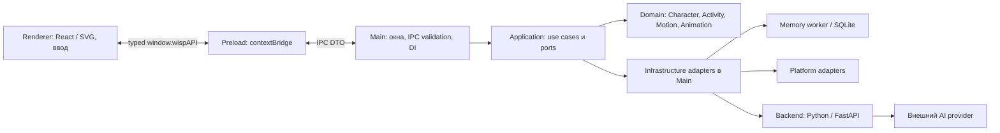

# Архитектурная карта Project Wisp

Карта текущих процессов и зависимостей. Правила слоёв — в [desktop AGENTS](frontend/AGENTS.md), серверные правила — в [backend AGENTS](backend/AGENTS.md), семантика — в [индексе контрактов](frontend/docs/engine/README.md).

## Процессы и поток данных

Main публикует полный Brain state; Renderer отображает его и передаёт пользовательский ввод. Domain определяет поведение, физику и semantic timelines. Завершение визуального клипа не управляет логикой персонажа. IPC-формы — [shared contracts](frontend/src/shared/ipc-contracts.ts), интерфейсы внешних возможностей — [Application ports](frontend/src/application/ports).

Renderer использует React/SVG: [SpriteRenderer](frontend/src/renderer/components/Character/SpriteRenderer.tsx). Локальные presentation resources и Skin не пересекают процессную границу. Точная геометрия и fallback — [Render](frontend/docs/engine/RENDER_ENGINE.md), порядок и cadence IPC — [UI](frontend/docs/engine/UI_SPEC.md).

## Desktop и backend

Desktop в `frontend/` и backend в `backend/` имеют отдельные runtime, зависимости и deployment: [ADR-017](docs/adr/ADR-017-monorepo.md). Корневые scripts только запускают команды этих приложений; [подготовка и команды](README.md#подготовка).

Сетевой путь: Application port → Infrastructure adapter в Main → backend API. Адаптер проверяет и преобразует wire response до использования Application. Backend формирует AI-ответ и хранит provider credentials; локальные FSM, физика, анимация и память принадлежат desktop. Недоступность сервера не останавливает локальные действия.

Текущая серверная поставка поддерживает v1 chat/touch. Наличие клиентских v2/v3 contracts не означает их поддержки встроенным сервером: [фактические возможности и gaps](backend/docs/README.md#фактическая-реализация).

Windows — первая платформа приёмки. ОС-зависимые возможности скрыты за platform adapters; Linux/macOS сохраняют capability fallback. Причины отдельных решений — в [ADR](docs/adr/README.md), пользовательские сценарии — в [каталоге поведения](frontend/docs/behaviors/README.md).
