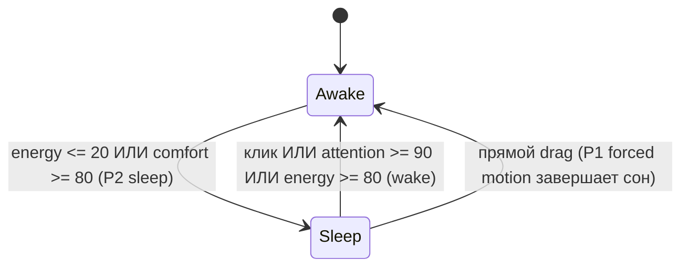
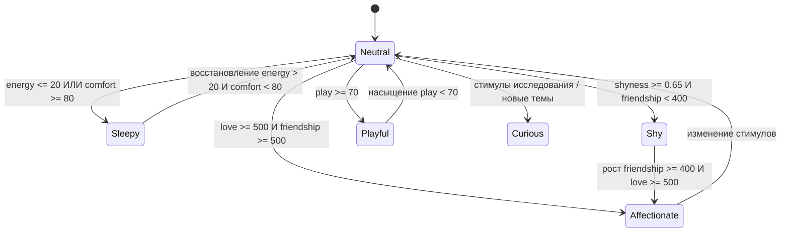

# Контракт Character Engine

Needs, отношения, личность/пластичность, romantic gating и эмоциональный тон. Типы/фабрики — в [src/domain/character/](../../src/domain/character); этот документ задаёт семантику.

## Владение

Domain ([character](../../src/domain/character), [behavior](../../src/domain/behavior)) владеет `CharacterState`, Needs/metabolism, Relationship, Personality, `IntimacyState`, tone, semantic gating и P4 Utility arbitration. Application нормализует `StimulusEvent` и формирует `CharacterSnapshot`; Renderer/provider не получают прямой доступ к Domain entities. [Ownership](README.md#4-матрица-межмодульных-контрактов-кто-от-кого-зависит).

## Поток ответственности

Provider/User/Timer/System → Application mapper; autonomy opportunity → candidates; Character gating/Utility → resolved `BehaviorIntent` → Behavior Brain selection → Runner → `AnimationIntent` → Animation Controller.

Character не выбирает Activity, physical outcome, sprites/frames. Policy: [Autonomy](AUTONOMY_ENGINE.md); intent ownership/forced-motion exceptions: [Behavior Intents](BEHAVIOR_INTENTS.md#поток-ответственности). Stimuli: [types.ts](../../src/domain/character/types.ts), lifecycle/dedupe: [Activity feedback](ACTIVITY_ENGINE.md#13-feedback-boundary).

## 1. Главная идея

Устойчивый характер, текущее настроение и постепенное доверие определяют инициативу, дистанцию, смущение и интересы Wisp; то же состояние служит психологическим контекстом AI.

## 2. Needs (Витальные потребности)

[needs.ts](../../src/domain/character/needs.ts): шкалы `0–100`. `energy` — ресурс (100 бодрость, 0 истощение); остальные — дефициты: `attention` (100 одиночество, 0 насыщение вниманием), `play` (100 скука, 0 удовлетворённый интерес), `comfort` (100 перегруз/стресс, 0 покой), `boredom` (100 монотонность).

### Поведенческая интерпретация:

- `energy <= 20`: короткие реплики, замедление, sit/sleep.
- `attention >= 80`: поиск контакта, меньшая дистанция, мягкие намёки.
- `play >= 75`: движение, cursor reaction, игривость.
- `comfort >= 80`: quiet/calm idle.

### Метаболизм и формулы дрейфа

[metabolism.ts](../../src/domain/character/metabolism.ts): drift к tone-dependent targets за интервал $\Delta t$ в часах:

$$V_{\text{new}} = V_{\text{current}} + (V_{\text{target}} - V_{\text{current}}) \times \left(1 - e^{-\text{ratePerHour} \times \Delta t}\right)$$

Дискретные click/pet/dialogue/feed effects — [stimuli-reducer.ts](../../src/domain/character/stimuli-reducer.ts).

### 2.1. Каноническая семантика сна и пробуждения

Единственный semantic sleep/wake owner — Character.

| Термин | Семантика и владелец |
|---|---|
| `sleep` | `BehaviorIntentKind`, принимаемый или инициируемый Character Engine для входа в сон. |
| `quiet` | `BehaviorIntentKind`: режим тишины (подавляет навязчивость и реплики), но сам по себе не является сном. |
| `wake` | `BehaviorIntentKind`, разрешаемый Character Engine для выхода из семантического сна. |
| `sleep_start` / `sleep_loop` / `wake_up` | Исключительно визуальные клипы [`ANIMATION_ENGINE.md`](ANIMATION_ENGINE.md); не принимают решений о поведении. |

P2 sleep срабатывает после P0 physics/P1 input. Direct drag (P1) прерывает сон через `drag -> land -> settle`, без ожидания `wake_up`. Внутренние respond/think/play/timer idle/wander сами не будят. Если после wake условие sleep ещё истинно, новый sleep допустим после приоритетного взаимодействия. Пороги и прямой click/wake заданы FSM выше.

### Просьбы о движении и право на отказ

Явная chat-команда — добровольный user `wander`, а не forced drag: P1 ownership даёт приоритет над занятием, но не отменяет Character admission. Character проверяет актуальный snapshot после once-only user input: semantic sleeping → `sleeping`; иначе `energy <= 20` → `low_energy`; иначе `comfort >= 80` → `overloaded`; иначе прогулка допустима по Character. Используется тот же источник порогов, что `requiresVitalSleep`; копирование чисел в parser/adapter/UI запрещено. Команда не будит персонажа и не откладывается до пробуждения. Quiet сохраняется и не запрещает спокойную явную прогулку. Stop допустим независимо от Needs/sleep: это cleanup, а не просьба продолжить нагрузку.

Во время прогулки пересечение vital sleep gate отменяет run с `critical_need`, затем продолжается штатный P2 sleep. Mood/tone и личность определяют формулировку локальной реплики, но не случайный отказ, новые friendship/consent пороги или изменение Needs. Прогулка не игра/автономное Explore: не выдаёт play/social/Explore completion rewards и не обучает предпочтения. Обычный once-only эффект принятого user message сохраняется; повторный callback и отказ не создают второй эффект. Physical availability/support проверяет Motion после Character, с отдельной фактической причиной отказа.

## 2.2. Устойчивый тихий режим (Quiet Mode)

Quiet — session mode Brain/Character gating context, default false. Включается user/settings `quiet`, выключается явной `SetQuietModeDTO`; idle/wake/completion/reply/Activity/provider его не выключают. Это не sleep/menu pause/autonomy disabled; sleep/wake пороги действуют, wake сохраняет quiet.

Разрешены P0/P1/P2, calm, безопасное ненавязчивое Explore/Rest. Подавлены unsolicited SocialBid, cursor gesture/approach, шумная play/Zoomies, talking behavior; gaze-only остаётся reflex. Прямые user play/chat проходят current gates, не обходят critical state и не снимают quiet. Ответ на direct chat доступен в dialogue presentation, unsolicited talking/gesture не обязателен.

Enable отменяет несовместимые active/deferred runs без восстановления. Disable создаёт одну fresh opportunity без очереди; budget/cooldowns сохраняются. Renderer reload получает mode из полного Brain snapshot; Main restart сбрасывает session mode, долговременная персистентность тихого режима не предусмотрена (сессионное состояние). [Команда/bridge/DTO](../../src/shared/ipc-contracts.ts), [budget/priority](AUTONOMY_ENGINE.md).

## 3. Relationship (Система отношений)

[types.ts](../../src/domain/character/types.ts): `friendship` — доверие/безопасность/привыкание, `love` — романтическая привязанность; обе шкалы `0–1000`, изначально `loveUnlocked: false`.

### Правила прогрессии:

Friendship растёт от регулярного контакта/dialogue/pet/совместного времени. Love unlock требует **`friendship >= 400` и `userConsentEnabled`**, без накрутки spam clicks. No-guilt: отсутствие пользователя не уменьшает friendship/love и не вызывает укоряющих реплик; offline decay запрещён.

`loveUnlocked` — историческая защёлка: указанный gate относится к переходу false → true. Отзыв consent не обязан стирать прошлую разблокировку или накопленное love; положительный love delta без текущего consent запрещён. Restore `loveUnlocked=true` при `userConsentEnabled=false` допустим и не является новым unlock/consent. Романтическое выражение всегда заново проверяет текущие условия §7; provider/extraction не меняют consent. Несоответствие существующего reducer переходному gate исправляется с отдельной регрессионной проверкой; memory restore не вводит ложный cross-field запрет исторического состояния.

## 4. Personality (Оси личности)

[types.ts](../../src/domain/character/types.ts): семь осей `0.0–1.0`: `openness` (любопытство/фантазия), `extraversion` (социальная инициатива), `agreeableness` (эмпатия/мягкость), `sensitivity` (глубина отклика), `playfulness` (игра/юмор), `boldness` (уверенность), `independence` (комфорт без постоянного внимания).

### Синтез производных черт

[derived-traits.ts](../../src/domain/character/derived-traits.ts), динамическая `shyness`:

$$\text{shyness} = \text{sensitivity} \times 0.45 + (1 - \text{boldness}) \times 0.35 + (1 - \text{extraversion}) \times 0.2$$

## 5. Soft Lock / Hard Lock и пластичность

[types.ts](../../src/domain/character/types.ts), [personality-plasticity.ts](../../src/domain/character/personality-plasticity.ts): `AxisValue` содержит `base` (identity), `current`, `softMin/softMax` (комфорт), `hardMin/hardMax` (абсолютные пределы), `plasticity` (скорость/глубина адаптации).

Soft lock допускает лишь краткий выход при сильных стимулах. Hard lock сохраняет identity; рост отношений не отменяет границы и не превращает самостоятельность в агрессию.

## 6. Авторский профиль Wisp (revision 2, gate #122)

Preset `curiousStubbornGirl` введён поставкой #123 как card revision `2`; уточнение речи #137 поставляет revision `3` по правилу ниже. Единственный authored source остаётся [personality-presets.ts](../../src/domain/character/personality-presets.ts), без копии личности в backend/lore/resources. Смысл профиля согласован в [#108](https://github.com/zyzycode/project_wisp/issues/108#issuecomment-6403891113): обычная девушка 21 года, глуповатая, упрямая, инициативная и любопытная к человеку. Есть ситуативное мнение, возможны реальные бытовые/безобидные фактические промахи с признанием поправки. Нет закреплённых хобби, любимых вещей, придуманной биографии или обязательного смущения. Возраст не создаёт consent.

Архитектурное решение #140, поставка #137: карточка — единственный источник характера
для LLM. Модель сама выбирает содержание, эмоциональное выражение и манеру ответа
по карточке, фактическим state/памяти/истории. Серверные примеры речи, few-shot и
подсказки обязательного смущения/юмора/жестов/нежности/вопросов запрещены.
Технический контракт формата, достоверности и допустимости действий сохраняется;
детали сборки — [Prompt Engine](../../../backend/docs/CONTEXT_PROMPT_ENGINE.md#личность-и-текущее-состояние).
Прямая речь без повествования о действиях/сценах задаётся одной краткой фразой карточки,
без каталога образцовых ответов. Это уточнение aiSelfConcept повышает card revision до 3;
preset id, остальные черты/оси, dynamic checkpoints и локальные правила не меняются.
Revision 2 — предыдущая поставка #123; обе стороны reference обновляются совместно,
без миграционного adapter или поддержки old+new. Не раздувать карточку удалённой режиссурой.

Ошибки возможны, но не обязательны: нет квоты ложных ответов, реткона «я специально», подделки evidence или фактов исполненных действий. Достоверные сведения о пользователе, consent, source of truth памяти и правила действий имеют приоритет. Своя позиция не разрешает давление, жестокость, бесконечный спор или продолжение после «стоп». Новые занятия, повторная инициативная отправка и долговременное обучение стилю поддержки не вводятся.

Числа — инженерное отображение этого характера на существующие оси, не новые вкусы. При создании `current=base`; plasticity каждой оси остаётся как в revision1 (§5/9), формулы/дельты learning, Needs, Utility и tempo не меняются:

| Ось | base | soft min–max | hard min–max | Причина |
|---|---|---|---|---|
| openness | 0.68 | 0.45–0.85 | 0.25–0.95 | Интерес к человеку/новому без назначения хобби |
| extraversion | 0.60 | 0.45–0.78 | 0.20–0.90 | Инициатива внутри прежних budgets |
| agreeableness | 0.62 | 0.50–0.85 | 0.35–0.98 | Своё мнение при сохранении эмпатии/границ |
| sensitivity | 0.58 | 0.40–0.72 | 0.25–0.90 | Отклик без постоянной ранимости |
| playfulness | 0.62 | 0.40–0.80 | 0.20–0.95 | Бытовая игривость без требования шутить |
| boldness | 0.55 | 0.40–0.75 | 0.20–0.90 | Прямота/упрямство без агрессии |
| independence | 0.68 | 0.45–0.88 | 0.25–0.98 | Спокойное собственное занятие без вины |

Критерий mapping: стартовая shyness=0.4985, ниже прежнего порога 0.65; даже край soft-области даёт ≤0.644. Формула §4 и приоритет tone §8 остаются общими, `shy` допустим как ситуативное состояние, а не обязательный core. `guarded` означает мало знакомства, а не приказ быть робкой; `close` не романтика. `expression`/tone не содержат скрытого второго архетипа; локальные нейтральные каталоги остаются допустимыми, реализация planned selector §8.1 не prerequisite этого профиля. Проверять узнаваемость на восьми сценах #108 отдельно от offline сборки.

### 6.1. Тихая поддержка после явной реплики

Application/Main владеет session latch `quietSupport`, default false, отдельно от ручного quiet (§2.2). Это bounded реакция на явный текст, не LLM-классификация эмоций/неудачной шутки. После реально опубликованного successful ordinary dialogue reply текущей conversation принимается полный direct user text «мне от этого не легче» / “that doesn't make me feel better”. Нормализация только NFC, trim, lowercase, `’`→`'`, удаление конечных `. ! ?` и пробелов; точное равенство одной из двух строк. Цитаты/добавочные слова/история/summary/fallback/автономная реплика не являются trigger. Предыдущий reply не доказывает, что был шуткой; общий «стоп» остаётся boundary, не распознавателем поддержки.

На accepted send, до async recall/provider, latch включается и инвалидирует queued/in-flight unsolicited speech; один локальный ACK публикуется по текущим dialogue identity/generation guards: новый speech key `support_quiet_ack`, RU «Поняла. Я рядом.», EN “I understand. I'm here.” Нет provider call, appraisal, suggestion, extraction, topic attempt или нового memory evidence. ACK — [QuietSupportAcknowledgementDTO](../../src/shared/ipc-contracts.ts), outcome `local/quiet_support`: strict parser запрещает memorySource/interestThread/extra keys для этого outcome, Renderer показывает обычную реплику без error/fallback warning. Пара сохраняется обычным history path с `memoryConfirmable=false`, её source исключён из подтверждения memory items/topic; extraction не запускается. Ввод пользователя не штрафуется и не считается hostile; обычный once-only user stimulus допустим, synthetic provider stimulus запрещён. Rejected/stale/busy command и duplicate sequence не включают latch и не переиздают ACK.

Support cue без явного `replyToInterestThread` обрабатывается до 200ms topic admission: `lastOffered` очищается, но confirmed topic не закрывается/не резервируется и попытка не расходуется. При явном `replyToInterestThread` сохраняется существующий topic path; цитата ответа по выбранной теме не является support trigger. После local ACK eligibility предыдущего successful reply потребляется, чтобы повтор cue считался следующим user continuation, а не повторным ACK. History persistence асинхронна и не задерживает ACK; failure не повторяет публикацию. В одной Main transaction enter/invalidate/generation guards предшествуют ACK, все поздние autonomous callbacks повторяют gate перед commit.

Latch подавляет новые/поздние SocialBid, cursor approach/игровые приглашения, unsolicited game/event/observation speech и follow-up инициативы; отменяет несовместимый текущий run через существующие lifecycle hooks. До recall, transport и commit все эти пути проверяют latch как quiet-compatible gate. Разрешены P0/P1/P2, sleep/wake, спокойные Rest/Explore, ненавязчивое собственное занятие. Нет нового таймера, очереди, budget refill, увеличения Need deficit или ручного quiet toggle. Прямое user play/touch проходит свои текущие gates и не снимает latch; пассивный курсор/AFK-return/restore/provider/tick тоже не снимают.

Следующий принятый user chat send сначала снимает latch, затем проходит обычный dialogue pipeline; он может снова включить latch только при новом eligible previous reply. Dialogue reset/detach/replaceStream и Renderer reload сохраняют latch в Main session; eligibility прошлого reply очищается, старый ACK не восстанавливается. Full memory reset, Main restart и dispose очищают latch/eligibility и инвалидируют pending ACK; manual quiet сохраняет свой lifecycle. Late results не снимают/не обходят latch. Порт [IQuietSupportRuntime](../../src/application/ports/dialogue-runtime.ts) — локальный, без wire/IPC/SQLite поля. Неизвестные парафразы остаются обычным диалогом по карточке и фактическому контексту, без отдельной серверной инструкции стиля поддержки: полнота NLP-распознавания здесь не заявляется.

## 7. Intimacy & Romantic Charge

[types.ts](../../src/domain/character/types.ts), [intimacy-rules.ts](../../src/domain/character/intimacy-rules.ts): `flirtiness` — внешнее проявление, `romanticCharge` — накопленное напряжение (оба 0–100); `userConsentEnabled`/`boundariesKnown` — consent/boundary flags.

### Условия разрешения романтического выражения (`canExpressFlirt`):

Все условия одновременно:
1. `userConsentEnabled === true`;
2. `relationship.loveUnlocked === true`;
3. `relationship.friendship >= 500`;
4. `needs.energy >= 30`;
5. `needs.comfort <= 60`.

## 8. Эмоциональный тон (Синтез настроения)

[types.ts](../../src/domain/character/types.ts), [emotional-tone.ts](../../src/domain/character/emotional-tone.ts): `SynthesizedEmotionalTone` пересчитывается на каждом tick по текущим Needs/axes/relationship.

### Приоритетная матрица синтеза:

1. `energy <= 20` или `comfort >= 80` → `sleepy`.
2. `shyness >= 0.65` и `friendship < 400` → `shy`.
3. `love >= 500` и `friendship >= 500` → `affectionate`.
4. `play >= 70` при достаточной энергии → `playful`.
5. Иначе `neutral`/`curious`.

## 8.1. Характер локальной игровой речи

Спецификация локальной игровой речи персонажа; базовый runtime использует сопоставление outcome+locale. Чистая функция в существующем Domain Character выбирает semantic line key, Application локализует его и ведёт speech lifecycle по [UI §6.1.1](UI_SPEC.md#611-cursor-game-v1-presentation). Это расширение Character, не новый движок. Main передаёт immutable `CharacterSnapshot` существующего Character service в момент первого допустимого attempt/outcome; Renderer получает только готовый текст. Повтор snapshot/tick не пересчитывает уже выбранную реплику.

**Разрешённые входы.** Реальная стадия `attempt` либо зафиксированный `caught/missed/lost_target/cancelled` из [Activity §17](ACTIVITY_ENGINE.md#17-cursor-game-v1); текущие `needs.energy/comfort` в `[0,100]`; `personality.traits.shyness/playfulness/boldness` в `[0,1]`; boolean `hadConfirmedCatchBeforeRun` по правилу ниже. Shyness вычислена существующей формулой §4, не выводится из текста. Время/run/generation управляют Application lifecycle, locale ru/en — только каталогом. Никаких LLM scores, dialogue summary, lore, заголовков окон, пользовательских команд «стань смелее», raw geometry или inference участия пользователя.

**Детерминированный выбор.** Первое подходящее условие: energy≤30 или comfort≥70 → `subdued`; иначе shyness≥0.65 → `reserved`; иначе playfulness≥0.60 и boldness≥0.50 → `playful`; иначе `neutral`. Проверять finite/range всех пяти чисел; missing/invalid snapshot → `neutral` без исторического варианта. Это tone речи, не изменение synthesizedTone/FSM/axes. Отдельного RNG, весов и дополнительного threshold friendship/романтики нет. Semantic key — разрешённая стадия + tone; только при `caught` и подтверждённом предыдущем catch добавить вариант `repeat_catch`. `cancelled` всегда silence. Полный конечный каталог — UI §6.1.1; другие combinations не порождают новые утверждения.

**Подтверждённый опыт.** Источник — существующий [GameEpisode](../../src/application/ports/memory-repository.interface.ts) с `kind=cursor_game`, `playCompleted=true`, `outcome=caught`, полученный через successful append acknowledgement [IGameEpisodeCommitObserver](../../src/application/ports/ai-event-provider.interface.ts) либо validated [IGameEpisodeReader.getRecent](../../src/application/ports/memory-knowledge.interface.ts). Он подтверждает только игровую поимку: не user engagement, удовольствие, победную серию, рост навыка или completed Activity status (после catch run мог быть отменён). Preference `activity.cursor_game` описывает иной вид evidence и не заменяет запись поимки; текущая неподтверждённая игра также не доказательство прошлого опыта.

Application хранит один RAM boolean `hasConfirmedCatch` для текущей memory generation, default false («нет доступного доказательства», не «никогда не играли»). При startup/restore допускается один `getRecent(20)` с budget200ms без ожидания игровой речи; только current-generation success до deadline может установить true. Поздний ответ/ошибка/пустой список оставляют текущее значение; retries/polling нет. Current-generation committed caught устанавливает true идемпотентно; повторы callbacks ничего не начисляют. Read/ack объединяются через OR, не затирая новое подтверждение. До первого `notice` каждого нового run Application фиксирует `hadConfirmedCatchBeforeRun=hasConfirmedCatch`; ack текущего run влияет только на следующий run, не переиздаёт речь. Пропущенный notice → false. Полный memory reset/смена generation очищают оба флага, инвалидируют pending read и текущую game speech; dispose также всё очищает. После restart — false до успешного bounded read. Отсутствие памяти оставляет обычный локальный каталог доступным offline.

Wiring read/observer, run snapshot и selector — **prerequisite будущей реализации**, сейчас в `CursorGamePresentation` их нет. Использовать существующие reader/commit observer через Main composition, сохранив подписку AI events; новая schema, durable counter, journal, migration, network call или public IPC DTO не нужны. Speech не создаёт stimulus/reward/preference sample, историю, факт или summary; once-only physical/Character effects §11 неизменны.

## 9. Taste & Preferences (Вкусы и предпочтения)

[preferences.ts](../../src/domain/character/preferences.ts): `value` `-100..100` — отношение к теме, `confidence` `0.0..1.0` — уверенность, `samples` — число тематических dialogues/events. Опыт, эмпатия и привязанность могут мягко сближать интересы с пользователем.

### Скорость и доказательства адаптации

LLM не назначает axes, affinity, relationship deltas или consent. Явный user fact и текущая роль — разные данные: `user.cursor_game=like` описывает пользователя, не немедленную любовь Wisp к игре. Источник learning — [проверенное сохранённое утверждение](MEMORY_ENGINE.md#9-p15-a02-явные-знания-и-простой-recall), а источники обычных axes effects — реальные принятые user interaction/завершённая Activity. Model reply, recall, загрузка истории, timeout/fallback и повтор результата не создают дополнительный experience reward.

Для axes вводится отдельный от Needs/отношений **5-minute adaptation gate**. Domain получает явные monotonic now и transient gate state; Main/Character service хранит state между вызовами. На startup/reset первая eligibility — now+300000 ms; после принятого experience — now+300000 ms, без catch-up/очереди. Restart не ускоряет развитие, поскольку заново начинается полное ожидание. Не изменять существующие immediate Needs/physical effects ради этого gate.

В eligible event применяются только уже определённые локальные направления `interactionDeltas`; raw delta каждой оси ограничен ±0.004 до умножения на plasticity, axis weight не выше1. Далее существующие soft resistance0.35 и hardMin/hardMax; base/limits/plasticity неизменны. `provider_response` не даёт axes delta: user send уже является опытом общения. Направления вне списка текущих реальных stimuli не выводятся из текста. Это максимум12 adaptations/час активного времени; фактическое изменение дополнительно ограничено plasticity/soft locks. Никакого offline catch-up.

Learned preferences: `activity.cursor_game`, `activity.explore`, `activity.social_bid` (§9.1). Новый **persisted** явный like/dislike из текущего user turn может дать один preference sample; failed write, повтор sourceMessageId, старый generation, startup replay и temporary role — ноль. Общий для всех ключей learning gate — 300000 ms со startup/reset задержкой; допускается не более одного sample на source и окно. Generation/current-turn admission и once-only terminal ownership остаются обязательны, bounded дедуп-кэш не разрешает принимать retired callbacks после eviction.

Формула чистого Domain reducer: target=+100 для like, −100 для dislike; `nextValue = clamp(oldValue + clamp((target−oldValue)*0.05, −2, 2), −100, 100)`. Новый key начинается с value0/samples0; `samples=min(samples+1,1000)`, `confidence=samples/(samples+6)`. Поэтому одна реплика даёт максимум2 пункта и confidence≈0.143, а уверенный интерес (≥0.5) требует минимум6 разнесённых во времени сообщений. Existing generic `trackPreference` не использовать без этой отдельной evidence policy; user command «стань игривой» не sample.

Preferences/axes сохраняются существующим snapshot v1; transient gates не сохраняются, не создают SQLite migration и не воспроизводят события при restore. Checkpoint crash window остаётся как у другой динамики: неподтверждённое последнее изменение может потеряться, но не догоняется двойным replay. Для сетевого memory-контекста learned preference показывается только при confidence≥0.5; текущий ответ и локальные решения сохраняют author identity/consent/priority gates. Обучение по исходам игр и выбор инициатив выполняются без повторного начисления существующих play effects.

Реализованный локальный потребитель learned preference описан в [AI Events §6](../../../docs/contracts/AI_EVENTS_CONTRACT.md#6-learned-preference-влияет-на-локальный-выбор-59): добавляется небольшой bias к шансу cursor notice только для уже допустимого зрелого игрового кандидата.

### 9.1. Расширенный локальный набор предпочтений

**Реализованные локальные предпочтения характера.** Существующая `activity.cursor_game` сохраняет reducer и consumer выше. Поддерживаются ещё ровно два ключа; произвольные темы, новая модель отношений, обучение от inferred knowledge/игровых исходов не входят в этот slice.

| Character key | Persisted user fact | Local consumer | Полная принимаемая фраза RU / EN |
|---|---|---|---|
| `activity.explore` | `user.explore` | Вес уже допустимого `wander` в `selectLocalActivity` | `Мне нравятся твои прогулки` / `I like your walks` → like; `Мне не нравятся твои прогулки` / `I dislike your walks` → dislike |
| `activity.social_bid` | `user.social_bid` | Вес уже допустимого `social_bid` в `selectLocalActivity` | `Мне нравятся твои инициативы общения` / `I like your social initiatives` → like; `Мне не нравятся твои инициативы общения` / `I dislike your social initiatives` → dislike |

Факт описывает предпочтение **пользователя**. Character постепенно учитывает его при своём выборе; прямого присваивания вкуса/оси нет. Негативный like/dislike sample — не команда отключения: явное quiet/settings применяется сразу по §2.2 независимо от learning gate. `social_bid` — существующий невербальный контакт, не романтика и не разрешение provider speech.

**Evidence и локальная память.** Наследуются whole-message нормализация, необязательный prefix/точка и persist ordering [Memory §9](MEMORY_ENGINE.md#9-p15-a02-явные-знания-и-простой-recall). Для двух новых фактов принимаются только формы таблицы; одно актуальное значение like/dislike на key в существующей `user_facts`. Успешные `appendTurn` и `upsert`, точный persisted user ID, current generation и once-only terminal admission обязательны до callback. Новое подтверждение того же значения с новым source ID может дать sample; correction даёт только один противоположный sample, не переписывает накопленное Character state.

Не evidence: «ты любишь гулять» (догадка модели/пользователя о Character), «я люблю гулять» (другая деятельность), «сегодня гуляй чаще», «будь общительной», «наверное, мне нравятся твои прогулки», цитата или «если…», две фразы/два ключа в одной реплике. Для SocialBid также исключены «друг любит твои инициативы общения», молчание/ignore и одно касание. Completed Explore/game, game win/loss, recall, импорт, summary, `important_event`/`shared_joke` сами не evidence. Непринятая фраза может остаться обычной репликой; модельный candidate без буквального совпадения не восполняет источник.

**Темп и дедупликация.** Формула value/confidence/samples выше применяется без изменений ко всем трём ключам. Один общий preference gate на персонажа (не по key), отдельный от axes gate: максимум один sample за 300000 ms; startup/restore/reset ждут полное окно, не копят очередь. Таким образом предел 12 samples/час и 24 пункта суммарного абсолютного изменения/час не умножается числом ключей. До confidence 0.5 новый consumer нейтрален. Значение ограничено ±100, samples ≤1000; mixed evidence меняет value постепенно, confidence означает количество проверенных наблюдений, а не согласие всех наблюдений.

Source дедуплицируется **до** проверки gate: пропущенный в cooldown source нельзя повторить после окончания окна. Один source может обновить лишь один key; источник не получает новый reward через другой callback/key. Существующие bounded cache и generation/terminal owner работают совместно: eviction не возрождает retired callback. Порядок принятых persisted turns сериализован существующей history queue; нет старых retry, startup replay или повторного sample из fact read. Failure записи даёт ноль, без rollback показанного reply и без learning retry.

**Влияние на выбор.** Character отдаёт только validated value/confidence двух ключей во внутренний `CharacterAutonomySnapshot`; Application/Main не вычисляют bias. В [локальном Utility](AUTONOMY_ENGINE.md#7-scoring-и-arbitration) для соответствующего eligible семейства умножить прежний положительный вес `w0` на `m = 1 + 0.20*(value/100)*confidence`. При отсутствии ключа, non-finite/out-of-range value/confidence или confidence <0.5: `m=1`. Итог `w=w0*m`; multiplier ∈[0.8,1.2], нулевой/запрещённый вес остаётся нулём. Это cap **веса**, не изменение вероятности на 20 процентных пунктов; вероятность остаётся `w/sum(w)`. Для остальных семейств `m=1`; cursor notice bias сюда не переносится и второй раз не применяется.

Порядок каталогов, один существующий RNG draw, relative-bucket выбор calm pose, cooldown/repetition и lifecycle сохраняются. Trace содержит baseline, multiplier и итоговый вес с новой tuning version, без source IDs/текста. Bias не создаёт candidate, не включает отключённое исследование, не меняет route/speed/outcome, не прерывает active peer Activity. P0–P3, quiet/menu, sleep/wake, consent, environment и общий initiative budget проверяются до/независимо от bias. Preference callback не вызывает `applyStimulus`: никаких дополнительных Needs/axes/friendship/love/game effects; обычный user dialogue сохраняет ровно свой существующий effect.

**Persistence и сеть.** Два user facts и два preference tracks используют существующие schema v1/snapshot v1, без migration или нового store. Restore читает tracks, не переучивает по последнему факту; unknown legacy tracks не становятся candidates. Full reset очищает facts/history/tracks и transient gates, поздние callbacks не возвращают их; checkpoint crash window прежний. При недоступной памяти новые samples запрещены, уже восстановленное локальное поведение продолжает работать offline.

Новые структурированные keys **local-only**: расширяется локальный recognizer/evidence port, но `MemoryFactKey`/`AIProviderMemoryContext` для provider и wire v1 остаются прежними allowlists. Перед сетью локальные facts исключаются до лимита пяти facts, новые tracks не проецируются; исходные dialogue строки подчиняются прежней политике передачи разговоров. Recognized новые fact-пары исключаются из recalled dialogue episodes, как старые registry-пары, чтобы correction не возвращалась устаревшим воспоминанием. Расширение сетевого контекста требует отдельного контракта обеих сторон; локальное расширение предпочтений его не разрешает.

**Контролируемая приёмка реализации.** Для каждого нового key независимо создать две чистые истории: шесть новых persisted like против шести dislike через 300000 ms, начиная на первой eligibility; время, ID-порядок, типы dialogue stimuli и все остальные входы одинаковы. Получаются value +12/−12, samples 6, confidence 0.5, multipliers 1.012/0.988. Различается только содержание явного утверждения, не количества общения/награды.

| Сценарий | Ожидаемое доказательство |
|---|---|
| Explore: awake; energy=51, comfort=0, boredom=24; localTraits по 0.5, пустая activity history; разрешены только calm и Explore | Baseline веса 1 и 1. Один RNG=0.5: like → `wander` (граница calm 1/2.012), dislike → `idle` (1/1.988). |
| SocialBid: те же energy/comfort/traits/history, attention=80, friendship=100; разрешены только calm и SocialBid; quiet=false, budget свободен | Baseline веса 1 и 1.92; attention/friendship проходят существующие Domain Utility eligibility gates. Одинаковый RNG=25/73 для обеих историй: like → `play` с family `social_bid`, dislike → `idle`. |
| Реальная service/Main projection | Сохранить авторские axes/одинаковые Needs без их подмены предпочтением; для каждого key взять RNG на baseline границе calm/(calm+target), зафиксировать его одинаковым для пары. Оба target веса положительны; победители расходятся так же. |
| Подтверждённый checkpoint → restart, затем full reset обоих профилей | Restore сохраняет tracks и различие при одинаковых контролируемых snapshot/environment/history/RNG; новый sample до 5 min запрещён. Reset удаляет tracks: обе истории дают один baseline выбор. Не сравнивать разные wall-time Needs/cooldowns как evidence предпочтений. |
| Одна реплика; пять samples; cooldown/spam; смена key; role/model/failed write; late callback после reset/dispose/eviction | До шести samples bias отсутствует; общий cap, source once-only и отсутствие ложного learning сохраняются. |
| quiet, critical sleep, menu, exhausted budget, disabled Explore; current consent=false; game terminal повторён | Запрещённый family не воскресает даже при +100/confidence=1; P2 и существующий cursor consumer сохраняются. Нет нового consent/relationship/game effect; обычный once-only outcome неизменен. |

Сценарии проверяются в [local-activity-preference](../../tests/domain/local-activity-preference.test.ts), [Main projection](../../tests/main/local-activity-preference.test.ts) и [memory restart](../../tests/application/memory-restart.test.ts). Trace использует tuning version `CHAR-I03-v1`.

## 9.2. Семантическое взаимодействие: общая карточка и локальная оценка

Спецификация семантической оценки взаимодействий. Единственный авторский
source общей карточки — [personality-presets.ts](../../src/domain/character/personality-presets.ts):
`curiousStubbornGirl`, revision `3` в поставке #137 по §6 (предыдущая поставка #123 — revision `2`). Все пользователи получают одинаковые aiSelfConcept, base,
soft/hard limits и plasticity. Правка авторской identity требует повышения revision;
provider switch, checkpoint, разговор и learning revision не меняют. Старые динамические
checkpoints восстанавливаются поверх установленной карточки по Memory §4; редактора нет.
[CharacterCardReference](../../src/application/ports/interaction-appraisal.ts) — ссылка,
не вторая карточка. aiSelfConcept целиком ≤500 UTF-16, overflow отклоняется до сети,
не молча обрезается. Backend получает reference в v1, projection
CharacterSnapshot и общие инструкции шкал; отдельного provider-specific характера нет.

Раздельны: immutable identity; быстрые Needs/tone (§2/8); отношения (§3/7);
медленные axes/preferences (§5/9). Energy растёт к бодрости, остальные Needs — дефициты;
friendship/love не проценты; traits — 0..1. Ответы разных моделей и людей не обязаны
совпадать, но не могут менять эту семантику или выдавать consent из текста.

### Проекция состояния для промпта

Domain Character предоставляет чистую производную текущего
`CharacterSnapshot` в существующем `character-snapshot.ts`; она не меняет snapshot,
FSM, числа, persistence или IPC. Application/Infrastructure получают результат
в момент построения запроса, не из кеша предыдущей реакции. Нового модуля движка нет.

| Значение | Domain-правило |
|---|---|
| pace=gentle | energy≤20 или comfort≥80; иначе normal, как приоритет sleepy tone |
| trust=guarded/familiar/close | friendship<400 / 400≤friendship<500 / friendship≥500 |
| attention=high | attention≥90; иначе ordinary, существующая граница выраженного дефицита контакта |
| play=high | play≥70; иначе ordinary, существующая граница playful tone |
| romanceAllowed | существующий `canExpressFlirt`: все текущие consent/state gates §7 |

Эти bands описывают состояние для модели: high attention не будит персонажа,
high play не запускает игру, close не создаёт consent. Комбинация gentle/high
attention/high play сохраняет все три факта. Модель самостоятельно выбирает их
выражение в речи, без предписанного темпа, жеста или приглашения. `ordinary` не означает нулевую
потребность. Boredom и traits остаются описательными полями исходного snapshot.

Использовать существующие Domain thresholds; допустимо вынести их в экспортируемые
константы существующих файлов и сузить вход `canExpressFlirt` до нужного structural
Pick без изменения функции. Не копировать числовые правила в Infrastructure/Python.
Обязательная wire-проекция и strict validation — [API §2.1](../../../docs/contracts/BACKEND_API_CONTRACT.md#21-проекция-expression).
Backend передаёт готовые значения и нейтральные определения их смысла, без
подбора примеров/стилевых подсказок и второго набора consent/Needs thresholds. Текущий локальный
stale signature и повторная проверка перед commit остаются независимыми.

### Факт, proposal и порядок

Один обычный клик означает только `touch`. Случайные stroke/ruffle/poke не описывают
фактический ввод и в API запрещены. Double/right click и drag не становятся новым touch
request; выбор иных жестов вне scope. Domain получает факт ввода сразу, до AI.
Для click/double_click/right_click базовые значения: attention −2, energy −0.2;
остальные deltas нулевые. При admission user_message заменяет старый chat reward
базой attention −4; остальные deltas нулевые. Эти базы работают и offline, но
ограничены общим 10s monotonic gate touch/chat: первая допустима сразу, повтор внутри
окна имеет нулевые числовые deltas. Ввод, wake, речь и запросы gate не блокирует.
Прочие explicit pet/play/feed stimuli сохраняют свои правила и не переименовываются в touch.

AI возвращает [InteractionAppraisal](../../src/application/ports/interaction-appraisal.ts),
не числа: category supportive/playful/boundary/hostile/neutral, intensity low/moderate,
confidence clear/uncertain. Supportive — забота/поддержка; playful — доброжелательная игра;
boundary — нежелательный контакт/просьба о дистанции; hostile — направленная явная
враждебность текущего сообщения, не отрицательная эмоция пользователя, несогласие,
цитата или просьба уйти. Uncertain означает отсутствие достаточного evidence.
Touch не может быть hostile. Intensity moderate разрешена только для ясного chat
смысла; обычный touch всегда low. Модель учитывает post-base snapshot и факт действия;
Domain проверяет category/intensity/confidence, current gates и применяет таблицу.

| Принятая оценка | Needs delta | Relationship delta |
|---|---|---|
| supportive, clear | comfort −1×k | friendship +2×k |
| playful, clear | play −2×k | friendship +1×k |
| boundary, clear | comfort +1×k | 0 |
| hostile, clear, только chat | comfort +2×k | friendship −1×k |
| neutral либо uncertain | 0 | 0 |

`k=1` для low, `k=2` для moderate. Clamp Needs 0..100, friendship 0..1000;
love/flirtiness/romanticCharge/consent/axes/preferences модельной оценкой не меняются.
Friendship decrease допустим только этой таблицей для explicit hostile chat; исторический
loveUnlocked не стирается. Unlock/романтическое выражение по §3/7 проверяются заново.
Дополнительно один общий **30s** gate semantic effect touch/chat: первая eligibility
startup/reset = now+30000, далее следующий nonzero accepted effect не раньше last+30000.
Это ограничивает скорость развития, не число запросов; suppressed/neutral/uncertain
не продлевают gate. Restart не позволяет обойти gate первым мгновенным reward.

Один logical interactionId + current generation: base и appraisal имеют разные once-only
receipts, оба не повторяются от callbacks/replay/recall. Main назначает возрастающий
local interaction sequence; Character service держит два generation-scoped high-water
marks (base/appraisal), а не бесконечный ID set. Старый/повторный sequence отклоняется;
callbacks обязаны сохранить исходную generation. Restart не replay-ит interactions.
Provider_response сохраняет
behavior candidate, но **нулевые** Needs/relationship/intimacy/axes effects во всех modes;
нормализация provider_response отделена от chat_message. Оценка не
начисляет old chat deltas поверх новой базы. Медленная adaptation остаётся отдельным
5-minute gate §9: максимум один реальный user stimulus; proposal/reply не второй sample.

### Свежесть и согласование реплики

Application запоминает post-base context signature: card reference, synthesizedTone,
energy bands ≤20 / (20,30) / ≥30, comfort ≤60 / (60,80) / ≥80, friendship <400 /
[400,500) / ≥500, loveUnlocked, current consent и четыре точных traits. На commit
сравнивает с текущим signature. Обычный drift внутри bands допустим: delta применяется
к **текущему** state, snapshot не восстанавливается. Смена band/consent/traits/tone,
reset/generation/dispose/deadline инвалидирует proposal; stale snapshot не rebased LLM.
Local input/physics никогда не ждут AI. Eligibility повторно проверяется при commit.

Effect и разрешённый текст публикуются одной Main semantic transaction. Prompt запрещает
числовые обещания и утверждения об уже изменённых отношениях/consent. Neutral/uncertain
ответ допускается без effect. Если nonzero proposal rejected/suppressed либо signature
изменился, исходный AI-текст не публикуется: touch получает локальную factual реплику
«Я заметила касание.» / “I noticed your touch.”; chat — существующий нейтральный
fallback без claim о принятой оценке. При touch offline/timeout/malformed — та же
локальная реплика один раз, если source/generation/input gates всё ещё актуальны;
после reset/dispose/drag silence. Повторного inference для исправления текста нет.

## 10. Сводная модель CharacterState v2

[types.ts](../../src/domain/character/types.ts), [character-snapshot.ts](../../src/domain/character/character-snapshot.ts): `needs`, `relationship`, `personality` (preset/axes), `intimacy`, `preferences`, `lastUpdated` (последний пересчёт).

## 11. Последствия и восстановление после активности

Play effect требует подтверждённой semantic play phase [Activity](ACTIVITY_ENGINE.md#16-auto-a09-единый-outcome-и-ownership). Request/admission/rejected play не уменьшают дефициты до Character gate; physical facts/direct pet stimuli сохраняются независимо от Activity.

Направления effects, once-only, clamp `[0,100]` обязательны. Deltas — начальный versioned tuning, не новые шкалы/пороги; неуказанные deltas нулевые.

| Подтверждённый факт | Начальные deltas |
|---|---|
| Explore completed | energy −1, boredom −8; одиночное исследование не даёт friendship/attention reward. |
| Завершённая игра | energy −3, play −15, boredom −18 (существующие play deltas). |
| Та же игра с `participation=user_engaged` | Дополнительно attention −3 и friendship +3, один раз. |
| Drag start / end | Только semantic lifecycle, нулевой дискретный reward/штраф. |
| Однократный drag hold | comfort +2; без friendship/love/игрового эффекта. |
| stumble / crash_landing | comfort +2 / +6; energy −1 / −2 соответственно. |
| soft landing, calm, SocialBid без ответа | Нулевой дискретный effect. |

Существующие play personality deltas — только за подтверждённую игру. Solitary play/cursor presence не доказывают социального участия. User input во время SocialBid даёт обычный stimulus, без второго reward за answered outcome. Cancel/failure до play phase не начисляет effect; пропорциональная оплата шагов/новый resource timer вне slice.

Reducer обрабатывает metadata `system_event.activityOutcome`, `dragRunId/heldMs`, `landingOutcome`; это не новые public intent kinds.

Единственный Needs clock — Brain/CharacterStateService. Semantic/stable sleep использует `sleepy` metabolism; approach/prepare/calm/quiet не включают его принудительно. Сам tone sleepy не доказывает сон. Defaults [metabolism.ts](../../src/domain/character/metabolism.ts): sleep energy →82, rate 0.3/hour; comfort →12, rate 0.32/hour. Nap 12 секунд не обязан восстановить energy полностью. Full sleep достигает wake threshold за конечное время; ускорение — только versioned tuning с временным сценарием, не скрытая поправка ради теста.

Pulse elapsed от последнего применённого Main-monotonic time: negative/non-finite отклоняется, повторное время не даёт drift. Catch-up максимум 60000 ms/transaction, избыток после stall отбрасывается без очереди. Outcome несёт `deltaMs=0` против двойного drift; тот же scheduler проверяет thresholds после Needs update.

P2 отменяет optional Activity/AI owner; pending intent не блокирует sleep/wake. Nap завершается Brain deadline, full user/vital sleep — Character wake gate. Skin/provider не будят автоматически; quiet после wake сохраняется.

## Архитектурные границы

Чистый Domain `frontend/src/domain/character/`; [общая изоляция](README.md#5-общие-архитектурные-границы-и-изоляция-clean-architecture).
